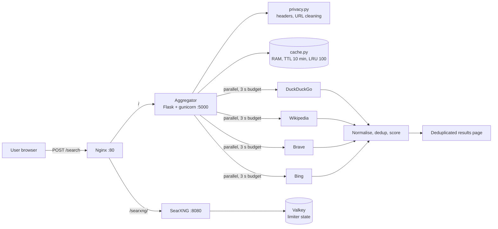

# Private Search Engine - Your Google, Without Tracking

A self-hosted, privacy-first meta-search engine. It sends your query to several
search engines in parallel, strips tracking parameters, removes duplicates,
ranks the merged list and shows it back to you, without cookies, accounts,
analytics, query logs or third-party scripts on the page.

The repository ships two things side by side:

- **`custom-engine/`** - a small, readable Python/Flask aggregator (under
  2,000 lines of application code) that shows meta-search, ranking, de-duplication and privacy
  engineering end to end.
- **`searxng/`** - a configured [SearXNG](https://docs.searxng.org/) instance,
  the production-grade option with many maintained engines and a built-in
  limiter.

Nginx sits in front of both: `/` goes to the custom engine, `/searxng/` goes to
SearXNG.

## Features

- Parallel fan-out to DuckDuckGo, Wikipedia, Brave and Bing with a 3 second
  per-request budget; a slow or blocked engine never blocks the page.
- URL normalisation, tracking-parameter stripping and de-duplication across
  engines, with a transparent scoring formula.
- Searches are `POST`-only, so the query never appears in the URL, the browser
  history or a `Referer` header. A `GET /search` is redirected (303) to `/`
  and never performs a search.
- Short-lived, RAM-only result cache (10 minutes, 100 entries, hashed keys).
- Nginx access log disabled, per-IP rate limit on `/search`, and Docker's `none` log driver so container output is never stored.
- Strict privacy headers (CSP, `Referrer-Policy: no-referrer`, and more), no
  `Set-Cookie`, no request logging.
- No external fonts, CDNs or analytics; the UI works with a system font stack
  and only `'self'` scripts and styles.
- Offline demo mode so you can try the whole pipeline with no network.
- Docker Compose stack (Nginx + custom engine + SearXNG + Valkey) and a
  one-command `./run.sh`.
- Test suite that runs offline, plus `./test.sh` for end-to-end checks.

## Privacy comparison

| | Google Search | DuckDuckGo | PrivateSearch (self-hosted) |
|---|---|---|---|
| Tracking / profiling | Uses search activity for personalisation when account and activity settings allow it (see the Google privacy policy) | Says it doesn't build user profiles (per its privacy policy) | No profiling code exists. No accounts, no identifiers, nothing stored about you |
| Ads | Shows ads alongside results | Shows ads in results (see its policy for how they are targeted) | None |
| Query logs | Search activity may be stored, subject to your account settings | Says it doesn't keep personal search histories (per its privacy policy) | The app never logs or writes queries to disk. Nginx `access_log` is off. The only copy is a hashed-key entry in an in-RAM cache that expires after 10 minutes |
| Cookies | Sets cookies (see its cookie policy) | Uses few cookies for settings (see its policy) | None set. `Set-Cookie` is removed from every response. Preferences live in `localStorage` in your browser |
| Query in URL / browser history | Query is normally in the URL | Query is normally in the URL | Query is sent in a POST body; the URL stays `/search` |
| Third-party scripts / fonts | Loads Google-hosted resources | Serves its own resources (check the current site) | None. CSP is `default-src 'self'`, system fonts only |
| Who controls the server | Google | DuckDuckGo | You |

Footnote: the Google and DuckDuckGo columns summarise those providers' own
published policies at the time of writing, in general terms. Policies change,
so check the current Google and DuckDuckGo privacy policies before relying on
this table.

**The honest trade-off.** Meta-search does not make you invisible to the
upstream engines. DuckDuckGo, Brave, Bing and Wikipedia still see each request
arriving from *your server's* IP address. What they do not receive is your IP
address, your cookies or any identity: the aggregator forwards only the query
text and generic browser-like headers (a rotated user agent, `DNT: 1`, no
cookies, a fresh session per request). If you self-host on a VPS, your VPS
provider and the upstream engines can see that server's traffic. Hosting it on
a machine you control and sharing it with other people (rather than only
yourself) makes queries harder to attribute to one person, but that is a
property of shared use, not a guarantee.

## Architecture



ASCII fallback:

```
Browser --POST /search--> Nginx :80 --/--> custom-engine :5000 (gunicorn, Flask)
                            |                  |
                            |                  +-- privacy.py  (headers, URL cleaning, no logging)
                            |                  +-- cache.py    (RAM only, TTL + LRU, hashed keys)
                            |                  +-- aggregator.py --ThreadPool (3 s)--> engines/
                            |                                        +-- duckduckgo.py (HTML scrape)
                            |                                        +-- wikipedia.py  (MediaWiki API)
                            |                                        +-- brave.py      (HTML scrape)
                            |                                        +-- bing.py       (HTML scrape)
                            |                                        +-- demo.py       (offline fixtures, opt-in)
                            |                                              |
                            |                                              v
                            |                                   normalise -> dedup -> score
                            |                                              |
                            |                                              v
                            |                                   deduplicated results page
                            +--/searxng/--> searxng :8080 --> valkey (limiter state, in memory)
```

## How it works

1. **Form POST.** The search form posts `q` to `/search`. The query is never in
   the URL. `GET /search` (even with `?q=...`) returns a 303 redirect to `/`
   and does not search. A JSON `POST` with `{"query": "..."}` is also
   supported and returns JSON.
2. **Sanitising.** The query has control characters removed, whitespace
   collapsed and is truncated to 512 characters.
3. **Cache lookup.** The key is a SHA-256 hash of the case-folded,
   whitespace-collapsed query plus the safe-search and language flags, so the
   raw query is never used as a key. The cache is a thread-safe in-memory
   TTL + LRU structure: entries live 10 minutes, at most 100 are kept, and
   nothing touches disk. It is only filled when at least one engine succeeded
   and returned results.
4. **Parallel fan-out.** Each enabled engine runs in a thread pool. The
   aggregator waits at most 3 seconds in total; engines that have not finished
   are reported as failed and abandoned, so one hung engine cannot block the
   response. An engine that answers with zero results counts as "ok"; only an
   exception or a timeout counts as "failed".
5. **Tracking-parameter stripping.** Every result URL has known tracking
   parameters removed (exact names such as `fbclid` and `gclid`, and prefixes
   such as `utm_`), keeping the order of the remaining parameters and the
   fragment.
6. **Normalise and de-duplicate.** The de-duplication key lowercases scheme
   and host, drops a leading `www.`, upgrades `http` to `https`, drops the
   fragment, default ports and a trailing slash, and sorts the remaining query
   parameters. Duplicates are merged: the longest non-empty snippet is kept and
   the title comes from the best-positioned occurrence. The URL shown to you is
   the cleaned original, not the normalised key.
7. **Scoring.**

   ```
   score = 10 * n_engines + sum( max(0, 10 - position) * 0.5 )  over every occurrence
   ```

   `n_engines` is the number of distinct engines that returned the URL and
   `position` is the 0-based rank within that engine. The score is rounded to
   two decimals; results sort by score (descending), then best position, then
   URL. Agreement between engines therefore matters most, and rank within an
   engine breaks ties.
8. **Render.** Results are rendered with only the domain, title, snippet and
   engine badges. Links carry `rel="noopener noreferrer nofollow"` and
   `referrerpolicy="no-referrer"`.

**Privacy headers** set on every response: `Referrer-Policy: no-referrer`,
`X-Content-Type-Options: nosniff`, `X-Frame-Options: DENY`, a restrictive
`Content-Security-Policy` (`default-src 'self'`, `script-src 'self'`,
`style-src 'self'`, `form-action 'self'`, `frame-ancestors 'none'`,
`base-uri 'none'`), a `Permissions-Policy` that disables interest-cohort,
browsing-topics, geolocation, camera and microphone, and
`Cross-Origin-Opener-Policy: same-origin`. `Set-Cookie` is removed and
`Cache-Control: no-store` is set. `/robots.txt` disallows `/search`. Nginx adds
its own header set, has `access_log off` and a critical-only error log, rate
limits `/search` per client IP (10 requests per second with a burst of 20,
state in shared memory only), and the compose file uses the `none` logging
driver for every service. The results page also uses a static `<title>`, so
the query does not end up in browser history through the page title.

## How to run

### 1. Quick start (custom engine only)

Requires Python 3.11 or newer.

```bash
pip install -r custom-engine/requirements.txt
python custom-engine/app.py
```

Open <http://127.0.0.1:5000>.

**Offline demo.** If your machine cannot reach the search engines (or you only
want to see the pipeline work), enable demo mode:

```bash
PSE_DEMO_MODE=1 python custom-engine/app.py
```

Demo mode adds two fixture engines, `demo_a` and `demo_b`. They return
clearly labelled `[Demo]` results on `example.com` / `example.org` domains,
with overlapping URLs, some carrying `utm_*` and `fbclid` parameters, so you
can watch de-duplication, tracking-parameter stripping and scoring happen
without any network access. Demo results are never real search results.

### 2. Production-style stack (Docker)

Requires Docker with the Compose plugin.

```bash
./run.sh
# or, manually:
docker compose up -d --build
```

- Custom engine: <http://localhost/>
- SearXNG: <http://localhost/searxng/>

`run.sh` creates `searxng/.env` from `searxng/.env.example` and generates a
random `SEARXNG_SECRET` if the file is missing or still holds the placeholder
`change-me`.

### Configuration

| Variable | Used by | Default | Purpose |
|---|---|---|---|
| `HOST` | `custom-engine/app.py` | `127.0.0.1` | Bind address when running `python app.py` directly |
| `PORT` | `custom-engine/app.py` | `5000` | Port when running `python app.py` directly |
| `PSE_ENGINES` | custom engine | all four real engines | Comma-separated list of engines to enable, e.g. `wikipedia,duckduckgo`. Demo names `demo_a`, `demo_b` and the fault-injection engine `demo_down` (always fails; for testing) are also accepted |
| `PSE_DEMO_MODE` | custom engine | off | `1`, `true` or `yes` adds the offline `demo_a` and `demo_b` engines |
| `SEARXNG_BASE_URL` | SearXNG | `http://localhost:8080/` in `searxng/.env.example` (standalone stack); `http://localhost/searxng/` for the root stack (override via root `.env`, see `.env.example`) | Public URL (with trailing slash) SearXNG uses to build links. In the root stack the root `.env` / shell value takes precedence over `searxng/.env`; set it to your real HTTPS URL in production |
| `SEARXNG_SECRET` | SearXNG (`searxng/.env`) | placeholder `change-me`; `run.sh` replaces it with a random value | Secret key for SearXNG; never commit it |

## Testing

```bash
./test.sh
```

Run it from the repository root. It does not need a running Docker daemon.

What it does:

0. Checks that the Python dependencies are importable.
1. Runs the full pytest suite (unit and integration tests, all offline).
2. Detects the network. If DuckDuckGo is unreachable (or you pass `LIVE=0`),
   it sets `PSE_DEMO_MODE=1` so the demo engines supply results; `LIVE=1`
   forces the real-network path.
3. Starts the app on `127.0.0.1:5055` (override with `PORT`), with the
   fault-injection engine `demo_down` enabled next to the four real engines.
4. Runs the eight requirement checks against the running app:
   - **T1** a search returns HTTP 200 with at least 5 results.
   - **T2** the query is not found anywhere in `logs/` or `data/`.
   - **T3** results are de-duplicated (all normalised URLs unique).
   - **T4** tracking parameters (`utm_`, `fbclid`, `gclid`) are stripped.
   - **T5** a repeated query is served from cache (`cached: true`) in under 100 ms.
   - **T6** the frontend loads, shows `PrivateSearch`, has no analytics or Google
     Fonts, `GET /search?q=...` returns 303, `Referrer-Policy: no-referrer` is
     set and no `Set-Cookie` is sent.
   - **T7** `docker compose config` is valid for the root and `searxng/` stacks
     (only if the `docker` CLI exists; otherwise it validates the YAML with
     Python when PyYAML is available and prints a warning).
   - **T8** with one engine deliberately failing, results are still returned and
     the failure is reported in `engines_failed`.
5. Hygiene checks: no leftover to-do style markers and no placeholder stubs in the sources.

**Offline auto-detect.** If the real engines cannot be reached, the real
engines fail gracefully and the demo engines still provide results, so the
checks above can complete without a network. When the network is available,
the checks run against the real engines. Note that T1 needs at least five
results, which on a blocked or offline network only the demo engines can supply.

To run only the unit tests:

```bash
cd custom-engine
pip install -r requirements-dev.txt
python -m pytest -q
```

## How to deploy on a VPS (Linode / DigitalOcean)

These steps are generic for any Ubuntu 24.04 VPS.

1. **Create the server.** Create an Ubuntu 24.04 Linode or DigitalOcean
   droplet and add your SSH public key during creation, so you can log in by
   key.
2. **Create a non-root user** with sudo and copy your SSH key to it:
   ```bash
   adduser deploy
   usermod -aG sudo deploy
   rsync --archive --chown=deploy:deploy ~/.ssh /home/deploy
   ```
   Log in as `deploy` from now on. Optionally disable password and root SSH
   login in `/etc/ssh/sshd_config` once you have confirmed key login works.
3. **Firewall.**
   ```bash
   sudo ufw allow OpenSSH
   sudo ufw allow 80/tcp
   sudo ufw allow 443/tcp
   sudo ufw enable
   ```
4. **Install Docker Engine** from Docker's official apt repository, following
   <https://docs.docker.com/engine/install/ubuntu/> (this also installs the
   Compose plugin). Optionally add your user to the `docker` group, as
   described in Docker's post-install steps.
5. **Get the code.**
   ```bash
   git clone <your-repository-url> private-search-engine
   cd private-search-engine
   ```
6. **Set the public URL.** Create a root `.env` from the example and set your
   domain (trailing slash included):
   ```bash
   cp .env.example .env
   sed -i 's#^SEARXNG_BASE_URL=.*#SEARXNG_BASE_URL=https://your-domain/searxng/#' .env
   ```
   `docker compose` reads the root `.env` automatically. (In the root stack this
   value overrides `searxng/.env`, whose default is meant for the standalone
   SearXNG stack on port 8080.)
7. **Start the stack.**
   ```bash
   ./run.sh
   ```
8. **DNS.** Create an `A` record for your domain pointing at the server's
   public IPv4 address (and an `AAAA` record if you use IPv6).
9. **HTTPS.** Use Let's Encrypt via Certbot (see
   <https://certbot.eff.org/instructions>). `nginx/nginx.conf` ends with a
   commented-out HTTPS template: a port 80 server that serves
   `/.well-known/acme-challenge/` from `/var/www/certbot` and redirects
   everything else to HTTPS, and a port 443 server using the certificate in
   `/etc/letsencrypt/live/<domain>/`. To use it: replace `example.org` with your
   domain, mount `/etc/letsencrypt` (and the webroot directory) into the Nginx
   container, publish `"443:443"` in `docker-compose.yml`, repeat the
   security-header and `location` blocks inside the 443 server, and enable the
   commented `Strict-Transport-Security` header. Issue the first certificate
   with a method that suits you (for example Certbot's standalone mode while
   Nginx is stopped, or the webroot mode), then reload Nginx. Certbot installs a
   renewal timer; make sure renewals reload Nginx.
10. **Updates.**
    ```bash
    git pull
    docker compose pull && docker compose up -d --build
    ```
    `pull` refreshes the SearXNG, Valkey and Nginx images; `--build` rebuilds the
    custom engine image from your checkout.
11. **Backups.** None are needed. The stack is stateless: the cache and the
    limiter state live in memory and nothing about users is stored. If you want to reuse the same
    SearXNG secret on a new server, keep a copy of `searxng/.env`.

## Project structure

```
private-search-engine/
  custom-engine/
    app.py  Dockerfile  .dockerignore  requirements.txt  requirements-dev.txt  pytest.ini
    search/
      __init__.py  types.py  aggregator.py  privacy.py  cache.py
      engines/
        __init__.py  base.py  duckduckgo.py  wikipedia.py  brave.py  bing.py  demo.py
    templates/   base.html  index.html  results.html
    static/      style.css  script.js  favicon.svg
    tests/       __init__.py  conftest.py  test_*.py
  searxng/       docker-compose.yml  settings.yml  limiter.toml  .env.example  (.env is generated, gitignored)
  nginx/         nginx.conf
  docker-compose.yml  .env.example  run.sh  test.sh  PLAN.md  README.md  LICENSE  .gitignore
```

## Limitations and honest notes

- **Scraping is fragile.** DuckDuckGo, Brave and Bing results are parsed from
  HTML. When an engine changes its markup, or blocks datacenter IP ranges or
  automated clients, that engine returns an empty list and the aggregator
  carries on with the others. Engines that crash or exceed the 3-second budget
  are listed as unavailable on the results page; an engine that is silently
  blocked just contributes no results. Expect to maintain the parsers. Wikipedia uses its API and is
  the most stable.
- **Not verified against live engines in every environment.** The test suite
  mocks HTTP, so passing tests show the parsing and merging logic works on
  saved samples, not that every engine currently accepts your server.
- **Images, Videos and News tabs are UI-only for now.** The backend returns the
  same combined web results for those tabs; only the Wikipedia tab filters.
- **Terms of service.** Automated querying of search engines may be restricted
  by their terms. Check the terms of DuckDuckGo, Brave, Bing and Wikipedia
  before running this beyond personal or demo use. Official, keyed search APIs
  are the sanctioned route for heavier use.
- **Meta-search is not anonymity.** Upstream engines see your server's IP (see
  the privacy section). Use a VPN or Tor for your own connection to the server
  if that matters to you.
- **Single worker.** The custom engine runs one gunicorn worker with threads so
  the in-memory cache is shared; it is built for personal or small-group use,
  not high traffic.
- **SearXNG autocomplete** is configured to use DuckDuckGo as the suggestion
  backend. SearXNG makes that request on your behalf, so DuckDuckGo sees the
  server, not you. Change `search.autocomplete` in `searxng/settings.yml` if
  you would rather not use suggestions.
- **POST-only results.** Because searches are POSTed (so queries stay out of
  URLs and history), pressing Back or Refresh on a results page makes the
  browser ask to resubmit the form. That is the trade-off for the privacy
  guarantee.
- **Run `./run.sh` rather than a bare `docker compose up` the first time.**
  `searxng/.env` ships with the placeholder secret `change-me`; `run.sh`
  replaces it with a random 32-byte secret.
- **Where this deviates from the original brief, and why.**
  - SearXNG has no `outgoing.user_agent` setting, so none was invented; SearXNG
    generates its own browser-like User-Agents (see the comment in
    `searxng/settings.yml`). The secret is a random value injected through
    `SEARXNG_SECRET` rather than written into `settings.yml`, so it is never
    committed.
  - The SearXNG limiter needs a Valkey instance, so the stacks include one
    (memory only).
  - Wikipedia gets a fixed, descriptive User-Agent instead of a rotating
    browser one, because the Wikimedia User-Agent policy asks API clients to
    identify themselves; the other three engines rotate.
  - DuckDuckGo is queried with a POST to `html.duckduckgo.com/html/` instead of
    `?q=` in the URL, so the query is not in the upstream request line either.
  - `test.sh` check 8 uses an opt-in fault-injection engine (`demo_down`, which
    always raises) so that "one engine down" is proven against the running app,
    not just in unit tests.
- **For production, prefer SearXNG.** It has maintained scrapers for many
  engines, and a built-in limiter. The custom engine is intentionally small and
  readable rather than exhaustive.

## What I learned

- **Meta search.** Merging results from engines that rank differently is mostly
  a normalisation problem: the same page shows up as `http` vs `https`, with
  and without `www.`, with tracking parameters, with redirect wrappers. Getting
  a good dedup key mattered more than the scoring formula, and rewarding
  agreement between engines turned out to be a simple, explainable ranking
  signal. A fixed time budget with graceful degradation made the whole thing
  feel reliable even when individual scrapers fail.
- **Privacy engineering.** Privacy is a pile of small, boring decisions: POST
  instead of GET so queries stay out of history, no-referrer so they do not
  leak to result sites, a CSP strict enough to forbid inline scripts and
  styles (which forced the UI to pass state through `data-*` attributes),
  hashed cache keys, and never putting a query in a log line or exception
  message. I also learned to be honest about what it does not do: the upstream
  engines still see the server.
- **Docker.** Splitting the stack into Nginx, the app, SearXNG and Valkey, and
  keeping everything stateless, made deployment a single command. Running one
  gunicorn worker to share an in-memory cache was a deliberate trade-off
  between simplicity and scale.
- **Rate limiting.** Scraping engines get you rate-limited or blocked, and
  hosting a search engine for others invites abuse. Treating HTTP 429 and 403
  as "skip this engine for now" rather than retrying, and relying on SearXNG's
  limiter backed by Valkey for the public-facing side, taught me that rate
  limiting runs in both directions: limits imposed on you and limits you need
  to impose.

## License

MIT. See [LICENSE](LICENSE). Copyright (c) 2026 Md Abu Baten.
